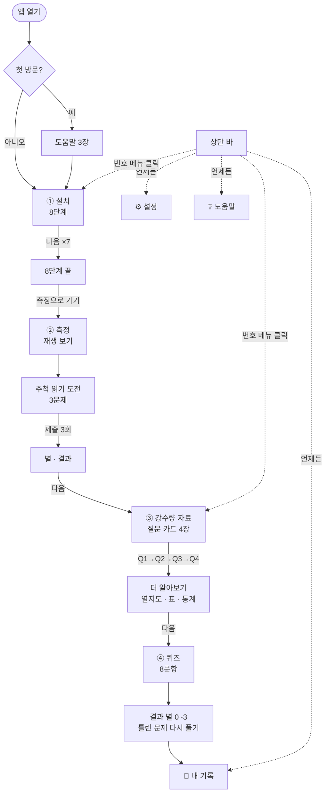
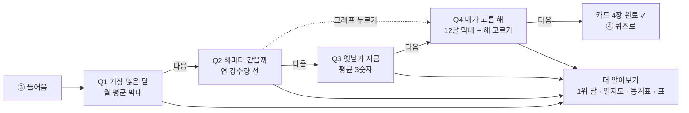

# 화면 흐름도·와이어프레임

> **목적**: 측우기 3D v2의 메뉴 흐름, 화면별 배치(데스크톱 / 폭 900px 이하 / 375px), 창(설정·내 기록·도움말·퀴즈)과 조작 방법을 정한다.
> **이 문서가 답하는 질문**: 학생은 어떤 순서로 어디를 누르나? 화면 크기마다 무엇이 어디에 놓이나? 키보드·터치로는 어떻게 하나?
> **관련 문서**: [00 PRD](00_PRD.md) · [01 핵심 로직](01_핵심로직_계산규칙_명세서.md) · [03 콘텐츠 스키마](03_학습콘텐츠_스키마.md) · [04 피드백](04_피드백_게이미피케이션_기획서.md) · [05 MVP·기술검증](05_MVP범위_기술검증.md)

신기전 v2와 **같은 뼈대**(상단 바 · 무대 · 오른쪽 패널 · 공통 창)를 쓰고 메뉴와 내용만 다르다. 모든 와이어프레임은 「보통」 글자 크기 기준이며 글자 크기를 키우면 패널이 길어져 안에서 스크롤한다.

## 1. 메뉴 흐름도



- 번호 메뉴는 순서를 안내할 뿐 **잠그지 않는다**. 어느 메뉴든 바로 눌러 들어갈 수 있다.
- 각 메뉴 끝의 「다음」 버튼이 다음 번호 메뉴로 이어 준다. 메뉴 제목 옆에 완료 표시(✓)가 붙는다.

## 2. 데스크톱 (폭 901px 이상, 예 1280×720)

### 2.1 ① 설치

```
┌──────────────────────────────────────────────────────────────────────────┐
│ 측우기 3D   ①설치✓ ②측정 ③강수량 자료 ④퀴즈        🏅내 기록 ❔도움말 ⚙설정 │
├───────────────────────────────────────────────┬──────────────────────────┤
│        ┌────────────────────────┐        [＋] │ 3 / 8  측우대 놓기        │
│        │ 측우대 놓기              │        [－] │ ●●●○○○○○                 │
│        └────────────────────────┘        [⟲] │                          │
│                                               │ 돌로 만든 받침대(측우대)를│
│               3D 무대                          │ 수평으로 놓아요. 땅에서   │
│       (대리석 측우대, 박석, 마당)               │ 튀는 빗물이 들어가지 않고 │
│                                               │ 늘 같은 높이에서 잴 수    │
│                                               │ 있어요.                   │
│  [끌어서 돌리기 · 휠로 확대]                    │ ┌──────────┐ ┌─────────┐│
│                                               │ │  ◀ 이전   │ │ 다음 ▶  ││
│                                               │ └──────────┘ └─────────┘│
│                                               │ ▶ 차례로 보기            │
│                                               │ ▸ 더 알아보기            │
│                                               │ ▸ 전체 단계 보기         │
└───────────────────────────────────────────────┴──────────────────────────┘
```

### 2.2 ② 측정 (보기)

```
┌──────────────────────────────────────────────────────────────────────────┐
│ 측우기 3D   ①설치✓ ②측정 ③강수량 자료 ④퀴즈        🏅내 기록 ❔도움말 ⚙설정 │
├───────────────────────────────────────────────┬──────────────────────────┤
│   ┌───────────────────────────────┐      [＋] │ 측정  [보기][주척 읽기]   │
│   │ 비가 내린다 — 빗물이 그대로 고인다 │      [－] │                          │
│   └───────────────────────────────┘      [⟲] │ 내린 비   ──●────  60mm   │
│                                               │                          │
│        3D 무대 (반 잘라 속 보기)                │ ┌──────────────────────┐ │
│        비 · 고이는 물 · 주척                    │ │      ▶  재생          │ │
│                                               │ └──────────────────────┘ │
│                                               │  雨水 深 三寸             │
│  [끌어서 돌리기 · 휠로 확대]                    │  (재생이 끝나면 나타남)    │
│                                               │ ▸ 자세한 값 (깊이 · mL)   │
│                                               │ ▸ 보기 방법 (반 자르기 ·  │
│                                               │   넓이 비교 · 장면 시간)  │
│                                               │ ▸ 왜 깊이만 재면 될까?    │
└───────────────────────────────────────────────┴──────────────────────────┘
```

접지 않은 조절 항목은 「내린 비」와 「재생」 2개뿐이다.

### 2.3 ② 측정 — 주척 읽기 도전

```
│ 측정  [보기][주척 읽기]                        │
│ 도전 2 / 3                         ★ ☆ ☆      │
│ 비가 내렸어요. 주척의 젖은 자국을 읽어 보세요.   │
│ [ ▶ 비 내리기 ]  (다시 보기 가능)               │
│  척 [−] 0 [+]   촌 [−] 3 [+]   푼 [−] 0 [+]    │
│ 힌트: 가장 짧은 눈금 1칸 = 1푼(2mm)             │
│ ┌──────────────────────┐                       │
│ │       확인하기        │                       │
│ └──────────────────────┘                       │
│ (확인 후) 정답 3촌 1푼 — 내 답과 1푼 차이, 성공! │
```

문제 중에는 3D의 이름표·물 깊이 숫자·「雨水 深」 문구를 가린다.

### 2.4 ③ 강수량 자료 — 질문 카드

이 메뉴는 3D 대신 왼쪽 전체에 **그래프 하나**를 보인다.

```
┌──────────────────────────────────────────────────────────────────────────┐
│ 측우기 3D   ①설치✓ ②측정✓ ③강수량 자료 ④퀴즈       🏅내 기록 ❔도움말 ⚙설정 │
├───────────────────────────────────────────────┬──────────────────────────┤
│ 월 평균 강수량                                  │ 질문 1 / 4               │
│ ■조선 ■근대 ■현재 평년                          │ 비가 가장 많이 오는 달은? │
│ mm                                            │ ●○○○                     │
│ 450│                                          │                          │
│ 300│            ▇ ▇ ▇  ←7월                   │ 답: 세 시대 모두 7월!      │
│ 150│          ▃ ▃ ▃ ▅  ▃                      │ 조선 358 · 근대 370 ·     │
│   0└──1월 2월 … 7월 8월 … 12월                 │ 현재 414mm                │
│                                               │ ┌────────┐ ┌──────────┐ │
│ 출처: Lee, Shin & Hong (2024) · 기상청 …        │ │ ◀ 이전  │ │ 다음 ▶   │ │
│                                               │ └────────┘ └──────────┘ │
│                                               │ ▸ 더 알아보기 (이 그래프) │
│                                               │ ▸ 더 많은 그래프          │
└───────────────────────────────────────────────┴──────────────────────────┘
```

- 「더 알아보기」(카드 안): 자세한 설명, 눈 못 잼 같은 한계, 출처.
- 「더 많은 그래프」(카드 밖): 해마다 1위 달 · 열지도 · 세 시대 통계 전체 표 · 표로 보기 · 치수와 자료의 출처. 하나를 고르면 왼쪽에 그 그래프 하나만 나온다.

### 2.5 ④ 퀴즈 / 창

퀴즈는 신기전 v2와 같이 **오른쪽 패널의 카드**에서 한 문제씩 푼다(창으로 열지 않음). 3D 무대에는 측우기가 천천히 돈다(움직임 줄이기면 멈춤). §5.4 참고.

## 3. 폭 900px 이하 (태블릿 세로 · 작은 노트북)

위 3D(또는 그래프) · 아래 패널. 3D는 화면 높이의 46%(키트 `46dvh`; v1은 최소 58vh). 패널은 가로 전체이며 위아래로 스크롤한다. 상단 바의 메뉴는 두 줄로 접히지 않게 글자를 줄이지 않고 **아이콘 모음**(내 기록·도움말·설정)을 오른쪽에 둔다.

```
┌────────────────────────────────────────┐
│ 측우기 3D  ①✓ ②  ③  ④       🏅 ❔ ⚙   │
├────────────────────────────────────────┤
│  ┌───────────────────┐            [＋] │
│  │ 측우대 놓기         │            [－] │
│  └───────────────────┘            [⟲] │
│           3D 무대 (높이 46%)            │
│                                        │
├────────────────────────────────────────┤
│ 3 / 8  측우대 놓기       ●●●○○○○○       │
│ 돌로 만든 받침대(측우대)를 수평으로      │
│ 놓아요. …                               │
│ ┌────────────┐  ┌────────────┐         │
│ │  ◀ 이전     │  │  다음 ▶     │         │
│ └────────────┘  └────────────┘         │
│ ▸ 더 알아보기   ▸ 전체 단계 보기         │
└────────────────────────────────────────┘
```

③ 강수량 자료에서는 위쪽이 그래프(높이 46%, 그래프가 길면 그 안에서 스크롤), 아래가 질문 카드다. 그래프 폭이 줄면 SVG를 다시 그리고 눈금을 줄인다(05 문서 §5).

## 4. 폭 375px (휴대전화 세로)

```
┌───────────────────────────┐
│ 측우기 3D        🏅  ❔  ⚙ │   ← 제목 + 아이콘
│ ①✓  ②  ③  ④              │   ← 번호 메뉴 한 줄(44px 높이)
├───────────────────────────┤
│ ┌───────────────────┐ [＋]│
│ │ 비가 내린다 …       │ [－]│
│ └───────────────────┘ [⟲]│
│     3D 무대 (높이 46%)     │
├───────────────────────────┤
│ 측정  [보기][주척 읽기]     │
│ 내린 비  ──●──  60mm       │
│ ┌───────────────────────┐ │
│ │       ▶  재생          │ │
│ └───────────────────────┘ │
│ 雨水 深 三寸               │
│ ▸ 자세한 값                │
│ ▸ 보기 방법                │
└───────────────────────────┘
```

- 좌우 여백 16px, **가로 스크롤 없음**. 메뉴는 번호+짧은 이름(①설치 ②측정 ③자료 ④퀴즈)으로 줄이고 눌렀을 때 전체 이름을 제목 띠에 보인다.
- 「조작 안내」 띠(`#hint`)는 3D 위에서 첫 방문에만 보이고 이후 숨긴다.
- ③ 강수량 자료: 그래프(가로 전체) → 질문 → 한 줄 답 → ◀ ▶. 열지도는 가로를 꽉 채우고 칸 누르기 대신 해 슬라이더를 함께 쓴다.

## 5. 창(대화 상자)

모든 창은 가운데에 뜨고 Esc·바깥 눌러 닫기·(닫기) 버튼을 지원한다. 375px에서는 화면 가득(여백 16px)과 아래에서 올라오는 시트 모양을 쓴다.

### 5.1 ⚙ 설정

```
┌───────────────────────────────────┐
│ ⚙ 설정                       [닫기] │
├───────────────────────────────────┤
│ 글자 크기     (●보통)(크게)(아주 크게)│
│ 화면 색       (●밝게)(어둡게)(고대비) │
│ 설명 수준     (●쉬운 설명)(자세히)    │
│ 그래픽 품질   (●자동)(낮음)(보통)(높음)│
│ 3D 이름표     (●켬)(끔)              │
│ 소리          (●켬)(끔)  ──●── 60%   │
│ 움직임 줄이기 (●기기 설정 따름)(켬)(끔)│
│ ───────────────────────────────── │
│ [ 기록 지우기 ]  진행 기록·배지 초기화 │
└───────────────────────────────────┘
```

바꾸는 즉시 반영한다. 「기록 지우기」는 한 번 더 확인(「정말 지울까요? 되돌릴 수 없어요」).

### 5.2 🏅 내 기록

```
┌───────────────────────────────────┐
│ 🏅 내 기록                    [닫기] │
├───────────────────────────────────┤
│ ① 설치 ✓   ② 측정 ✓   ③ 자료 ○   ④ 퀴즈 ✓ │
│ 퀴즈 최고  ★★☆  (7 / 8)            │
│ 주척 읽기  ★☆☆                      │
│ 배지 (3 / 7)                        │
│  [터 닦은 이] [첫 빗물] [눈금 읽기]   │
│  [ ? ] [ ? ] [ ? ] [ ? ]            │
│ 이 기록은 이 기기에만 저장돼요.        │
└───────────────────────────────────┘
```

잠긴 배지는 「?」와 획득 조건 한 줄을 보여 준다(04 문서).

### 5.3 ❔ 도움말 (첫 방문 3장, 이후 ❔로 다시 열기)

```
┌───────────────────────────────────┐
│ 1 / 3  무대를 돌려 보세요            │
│  [그림: 손가락으로 끌기 · 두 손가락 확대] │
│  끌면 돌고, 휠·두 손가락으로 크게 봐요.  │
│  [이전]  [다음]   (한 번 닫으면 다시 자동으로 안 뜸) │
└───────────────────────────────────┘
 2 / 3  번호 순서대로 ①→④ (✓가 붙어요)
 3 / 3  ⚙ 설정에서 글자 크기·소리를 바꿔요
```

### 5.4 ④ 퀴즈 (패널 카드 — 아래 그림은 카드 안 내용)

```
┌───────────────────────────────────┐
│ 3 / 8 · 맞힌 수 2             [닫기] │
│ 측우대를 땅보다 높게 둔 까닭으로      │
│ 가장 알맞은 것은?                    │
│ ┌───────────────────────────────┐ │
│ │ ① 보기 좋게 하려고               │ │
│ │ ② 땅에서 튀는 물이 들어가지 않게  │ │
│ │ ③ 물을 빨리 증발시키려고          │ │
│ │ ④ 도둑을 막으려고                │ │
│ └───────────────────────────────┘ │
│ (고르면) 정답! 튀어 오르는 빗물과 …   │
│                          [다음 ▶]   │
└───────────────────────────────────┘
 결과: ★★☆  7 / 8   [틀린 문제 다시 풀기] [처음부터] [내 기록]
```

## 6. 강수량 자료 질문 카드 흐름



| 카드 | 한 번에 보이는 것 | 한 줄 답이 바뀌는 때 |
|---|---|---|
| Q1 | 월 평균 막대 한 개. 7월 값이 라벨로 표시(v1 `labelMonth: 6`) | 고정(자료에서 계산) |
| Q2 | 연 선 + 11년 이동 평균 + 시대 평균 점선. 그래프를 누르면 그 해로 Q4 이동 제안 | 고정 |
| Q3 | 시대 세 가지 평균 큰 숫자 · 시대 색 막대 한 줄 | 고정 |
| Q4 | 고른 해 12달 막대 + ◀ ▶ + 슬라이더(1778~2026) | 해를 고를 때마다 갱신 |

카드 4장을 모두 열면 ③에 ✓가 붙는다. 「설명 수준」이 「자세히」이면 「더 알아보기」가 처음부터 펼쳐진다.

## 7. 키보드·터치 조작 표

| 하는 일 | 키보드 | 터치 / 마우스 |
|---|---|---|
| 앞뒤 이동(설치 단계, 질문 카드) | ← / → | 「이전」「다음」 버튼, 단계 점 누르기 |
| 메뉴 이동 | Tab → Enter, 또는 숫자 1~4(v2 신규) | 번호 메뉴 누르기 |
| 3D 돌리기 | (포커스 후) 방향키 — v2 신규 | 한 손가락/왼쪽 버튼 끌기 |
| 3D 확대·축소 | + / − (v2 신규), 휠 | 두 손가락 벌리기·오므리기, 오른쪽 위 ＋ － |
| 처음 시점 | 0 (v2 신규) | ⟲ 버튼 |
| 재생 / 멈춤(측정) | 스페이스 | 「재생」 버튼 |
| 내린 비 조절 | ← / → (2mm씩) | 슬라이더 |
| 주척 읽기 숫자 | ↑ / ↓, Tab으로 척→촌→푼 | [−] [+] 버튼 |
| 퀴즈 보기 고르기 | 숫자 1~4, Enter | 보기 누르기 |
| 그래프에서 해 고르기 | 슬라이더 ← / →, 「앞 해」「다음 해」 | 그래프 누르기, 슬라이더, ◀ ▶ |
| 그래프 값 보기(툴팁) | 포커스 후 ← / → | 마우스 올리기 / **탭하면 표시, 바깥 탭하면 닫힘** |
| 창 닫기 | Esc | 바깥 누르기, 닫기 버튼 |
| 설정·기록·도움말 열기 | Tab | 상단 아이콘 |

- 모든 누르는 곳은 높이 44px 이상, 초점 표시는 2px 윤곽선(v1 `:focus-visible` 유지).
- 창이 열리면 첫 요소로 초점을 옮기고 닫으면 열었던 버튼으로 되돌린다.
- v1은 `Esc`로 퀴즈만 닫았다. v2는 모든 창에 적용한다.
